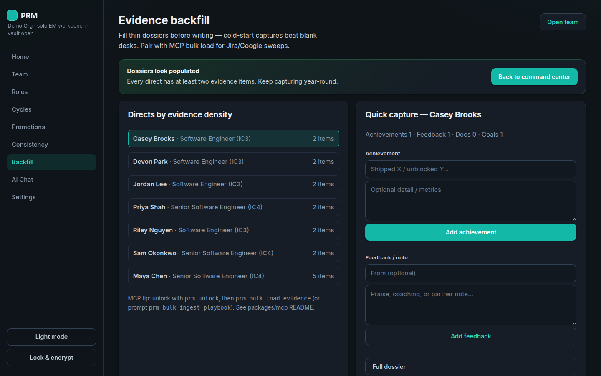
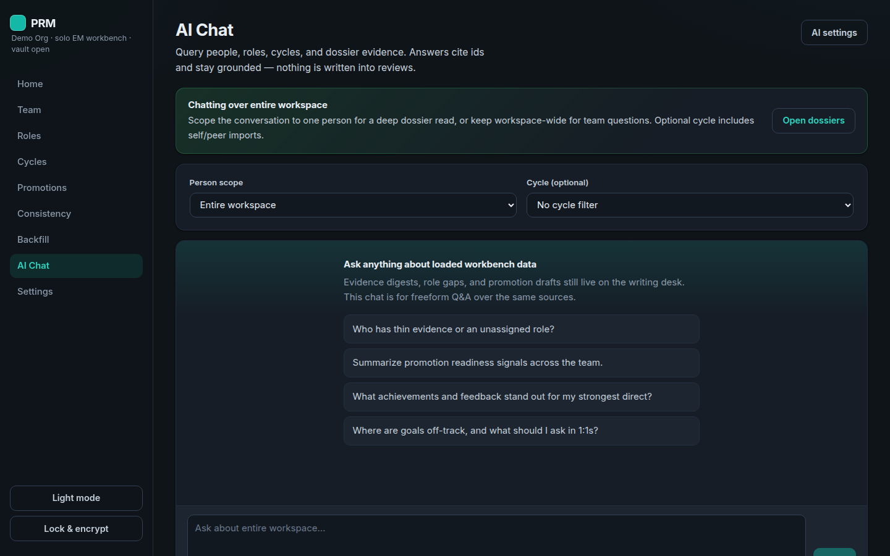
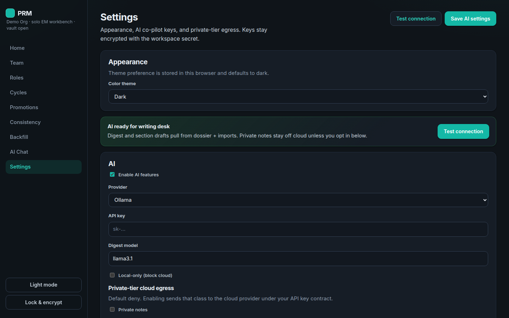

# Performance Review Manager

Local **solo EM workbench** for evidence-backed performance reviews and promotion cases.

ICs never log in. Self/peer input arrives as JSON import bundles. Your vault stays on disk — **Lock & encrypt** seals SQLite + files at rest.

<p align="center">
  
</p>

## Quick start

```bash
pnpm install
pnpm rebuild better-sqlite3   # if native module missing
pnpm dev
```

| | |
|---|---|
| UI | http://localhost:5173 |
| API | http://127.0.0.1:8787 |
| Seed password | `workbench` |

First load: **Create & seed demo team** (8-person org), then unlock. Between sessions use **Lock & encrypt**.

### Desktop (Tauri)

```bash
pnpm desktop:dev      # native window (needs WebView + Rust)
pnpm desktop:build
```

See [`apps/desktop/README.md`](./apps/desktop/README.md).

### Cursor MCP (bulk load)

`@prm/mcp` unlocks the vault and writes dossier evidence — pair with Jira/Google MCPs for cold-start backfill.

```bash
pnpm mcp
```

Setup: [`packages/mcp/README.md`](./packages/mcp/README.md) · [`.cursor/mcp.json.example`](./.cursor/mcp.json.example).

---

## Screens

Regenerate with `pnpm screenshots` (UI + API running; default password `workbench`).

### Unlock

Encrypted vault entry. Seed password `workbench`.


### Home — command center

Who to unblock next: roles, self bundles, then writing.


### Team

Directs roster. Open a dossier to capture year-round evidence.


### Person dossier

Achievements, goals, feedback, and documents — the citation pool for writing.


### Roles

Assign current (+ next) RoleDefinitions — the evaluation bar.


### Cycles

Export/import self & peer JSON bundles outside the app.


### Writing desk

Competency scores + evidence links → bias lint → finalize (citation snapshots) → share HTML/PDF.


### Promotions

Next-role packets for skip-level / promo cases.


### Consistency

Rating distribution and side-by-side drafts before you finalize.


### Backfill

Fill thin dossiers (or pair with MCP bulk load) so cold-start writing isn’t empty.



### AI Chat

Grounded Q&A over workspace/dossier data — cites ids, doesn’t invent evidence.



### Settings

AI provider, egress gates (including document extracts), theme.



---

## What’s in this slice

- **Encrypted vault** (AES-256-GCM) for DB + dossier files on lock  
- **People / roles / cycles** with self & peer JSON bundles  
- **Writing desk** — competencies, evidence links, citation freeze, HTML/PDF subject packets  
- **Consistency** view + **bias/tone lint** before share  
- **Promotions** against next-role expectations  
- **Backfill** wizard + MCP bulk load for thin dossiers  
- **AI** — digests, section draft, peer synthesize, chat (Anthropic / OpenAI / Ollama) with citation allowlist  
- **Dark / light** theme preference  

## Docs

Product & architecture under [`/docs`](./docs). Core loop evaluation: [`docs/CORE_LOOP_EVAL.md`](./docs/CORE_LOOP_EVAL.md). Cursor cloud notes: [`AGENTS.md`](./AGENTS.md).
