# Performance Review Manager

Local **solo EM workbench** for evidence-backed performance reviews and promotion cases.

ICs never log in. Self and peer input arrives as JSON import bundles. Your vault stays on disk: **Lock & encrypt** seals SQLite and dossier files at rest.

<p align="center">
  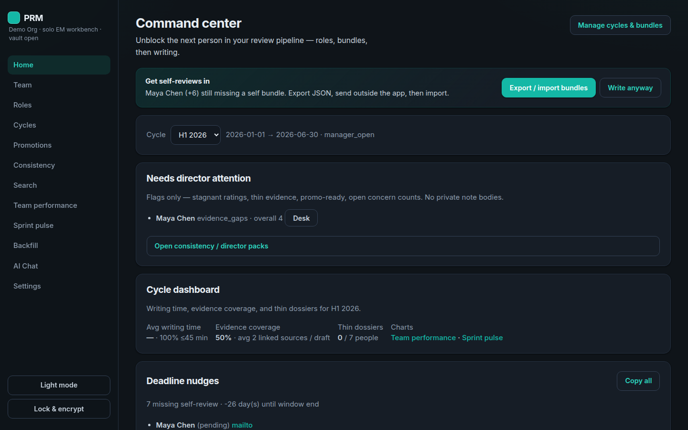
</p>

## Why this exists

Most review tools are either a shared HR portal (everyone logs in) or a blank Google Doc. This app is for one engineering manager who wants:

1. **A year-round dossier** so writing season is not a scavenger hunt
2. **Role frameworks as the bar** so ratings map to expectations, not vibes
3. **Evidence-linked drafts** so extreme scores and promo claims stay grounded
4. **Local custody** so private notes and underperformance plans stay on your machine until you export

The product is intentionally single-user. Peers and ICs participate by filling exported forms that you import back. That keeps anonymity and trust simple for v1.

## Core loop

```
upload role R&R → assign people → capture dossier evidence
  → open a cycle → import self/peer bundles → writing desk (+ AI)
  → consistency + team performance check → share export → history / promo packets
```

| Stage | Intent |
|-------|--------|
| Roles + people | Define what "good" means before you score anyone |
| Dossier | Accumulate achievements, goals, feedback, docs, and concerns all year |
| Cycle + bundles | Time-box the review without building a multi-user portal |
| Writing desk | Draft, cite, lint, finalize, then share a subject packet |
| Consistency / team performance | Catch clustering, thin evidence, and odd rating shapes before you ship |
| Promotions | Reuse the same role bar for next-level / promo cases |

## Quick start

```bash
pnpm install
pnpm rebuild better-sqlite3   # if native module missing
pnpm dev
```

| | |
|---|---|
| UI | http://localhost:5173 |
| API | http://127.0.0.1:8787 |
| Seed password | `workbench` |

First load: **Create & seed demo team** (8-person org), then unlock. Between sessions use **Lock & encrypt**.

Requires **pnpm 10.33.3** (see [`AGENTS.md`](./AGENTS.md) if Corepack hands you pnpm 11).

### Desktop (Tauri)

```bash
pnpm desktop:dev      # native window (needs WebView + Rust)
pnpm desktop:build
```

Packaged builds on `main` CI upload installers as Actions artifacts (`desktop-windows-x86_64`, `desktop-macos-aarch64`, `desktop-linux-x86_64`). Details: [`apps/desktop/README.md`](./apps/desktop/README.md).

The desktop shell spawns a bundled Node API sidecar, injects `window.__PRM_API_BASE_URL__` + launch token into the webview, and stores vault data under the OS app-data directory (not a CI build path). If unlock hangs, check `desktop-api.log` next to the vault.

### Cursor MCP (bulk load)

`@prm/mcp` unlocks the vault and writes dossier evidence. Pair it with Jira, Bitbucket, or other MCPs when you need a cold-start backfill instead of typing every note by hand.

```bash
pnpm mcp
```

Setup: [`packages/mcp/README.md`](./packages/mcp/README.md) · [`.cursor/mcp.json.example`](./.cursor/mcp.json.example).

---

## Screens

Regenerate with `pnpm screenshots` (UI + API running; default password `workbench`).

### Unlock

**Intent:** Keep the workspace sealed when you walk away. The unlock gate is the trust boundary for local data.

**How it works:** On first run you create a workspace password and can seed a demo org. Later sessions decrypt the vault with that password. **Lock & encrypt** re-seals SQLite and files so a stolen laptop disk is not a readable review archive.

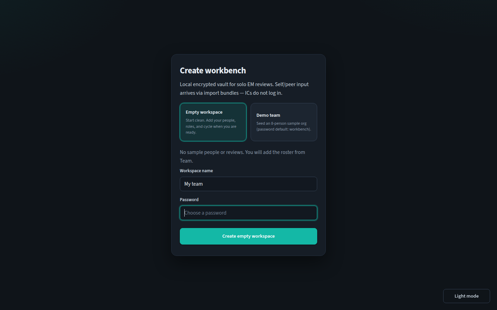

### Home (command center)

**Intent:** Answer "who is blocked, and what should I do next?" without hunting through every page.

**How it works:** Pick a cycle to see pipeline status (self / peer / manager), deadline nudges for missing self reviews, and a compact cycle dashboard (writing time, evidence coverage, thin dossiers). Links out to writing desks, backfill, and team performance when the numbers look thin.


### Team

**Intent:** Maintain the roster of directs you actually manage reviews for.

**How it works:** List, add, or CSV-import people, then open a person to work their dossier. This is the directory, not the evaluation surface. Role assignment and cycle participation hang off these records.

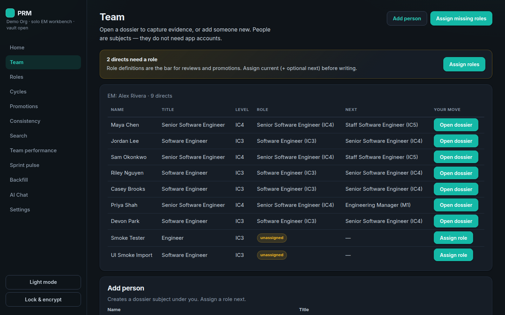

### Person dossier

**Intent:** Build a citation pool all year so the writing desk is not empty in week one of reviews.

**How it works:** Capture achievements, goals, feedback (with optional 1:1 theme tags), documents, concern / underperformance notes, and external links (for example Jira or Bitbucket sync). The **Timeline** panel stitches those events with manager reviews and rating decisions so you can prep a 1:1 without opening five pages. Visibility controls keep EM-only material out of subject exports. AI digests and drafts pull from this pool (and from concerns only when you opt them in).

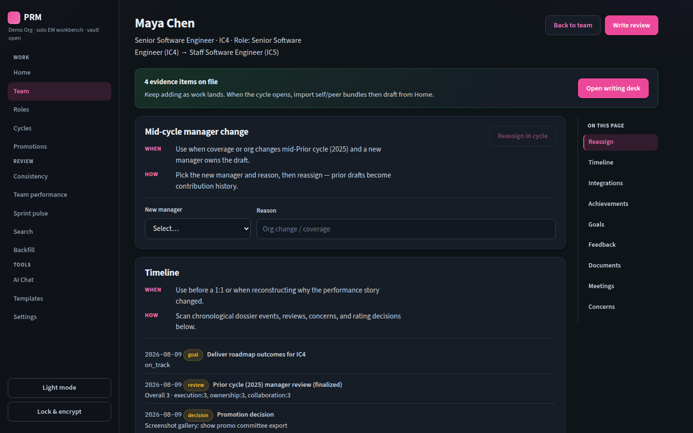

### Roles

**Intent:** Make the evaluation bar explicit. Ratings should map to role expectations, not a private mental model.

**How it works:** Author or import RoleDefinitions (ladder levels, competency keys, expectations). Assign each person a current role and optionally a next role for promo / gap work. Uploaded R&R docs can be structured manually or with AI extract. Writing desks and promotion packets read from these definitions.

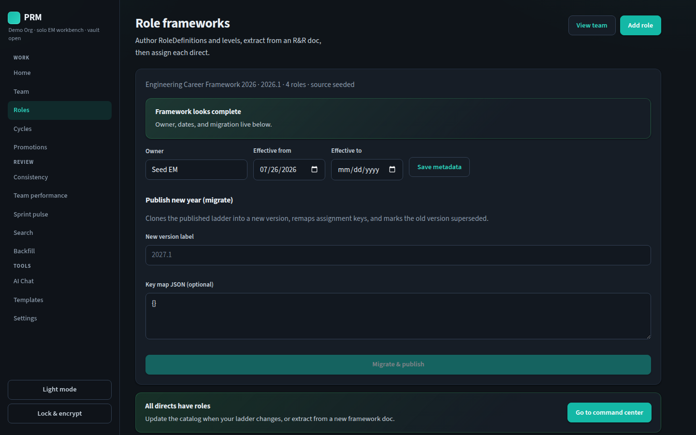

### Cycles

**Intent:** Time-box a review season and collect self / peer input without live IC login.

**How it works:** Create a cycle with a window and soft phases. Export JSON bundles for self and peer forms, collect them outside the app, then import responses. Waive with a reason when someone is not returning a form. Participants snapshot who was on the team for that cycle.

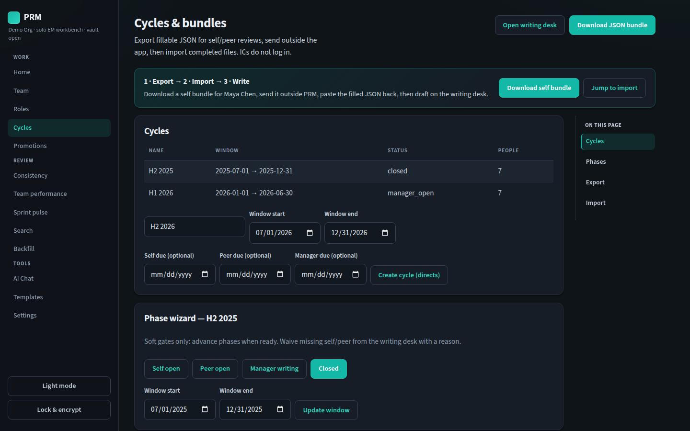

### Writing desk

**Intent:** Produce an evidence-backed manager review in a bounded amount of time (target ≤45 minutes per person).

**How it works:** Score competencies and overall against the assigned role, link dossier evidence to non-middle scores, draft narrative sections (optionally with AI from an allowlisted citation set), run bias / faithfulness lint, log decision reasons when ratings move, then finalize. Finalize freezes citation snapshots. Share exports HTML (print to PDF) with private notes and EM-only sources stripped.

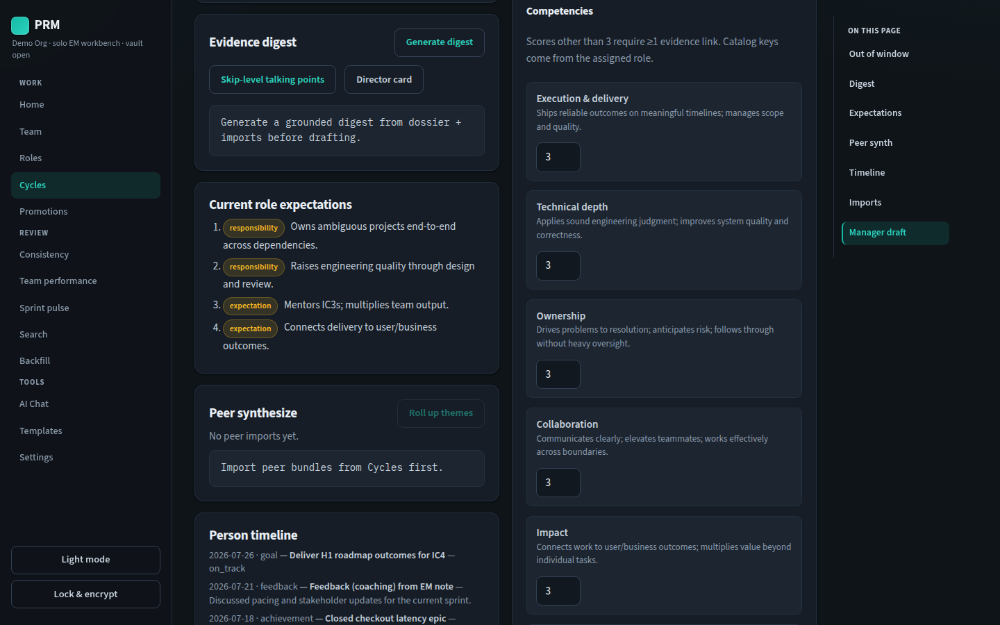

### Promotions

**Intent:** Reuse the same role bar for next-level and promotion cases instead of a parallel doc pile.

**How it works:** Open a promotion packet against a target RoleDefinition. Mark gaps / demonstrating signals, draft the case (optionally with AI), and keep it alongside the cycle review history so skip-level conversations stay evidence-backed.

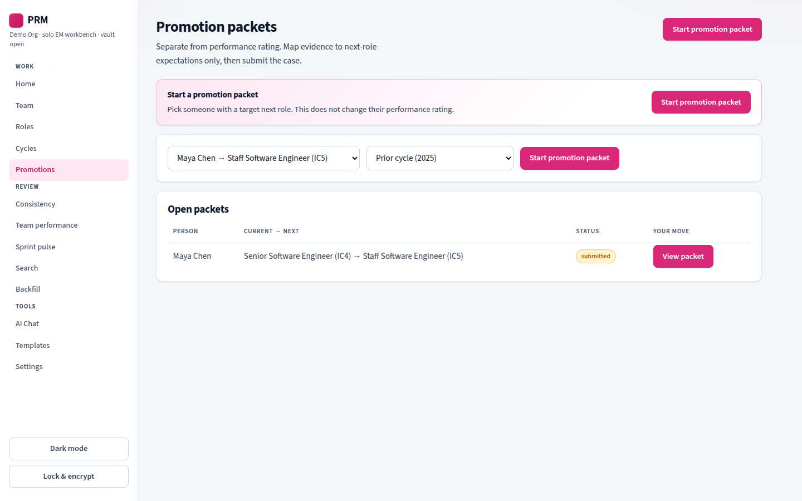

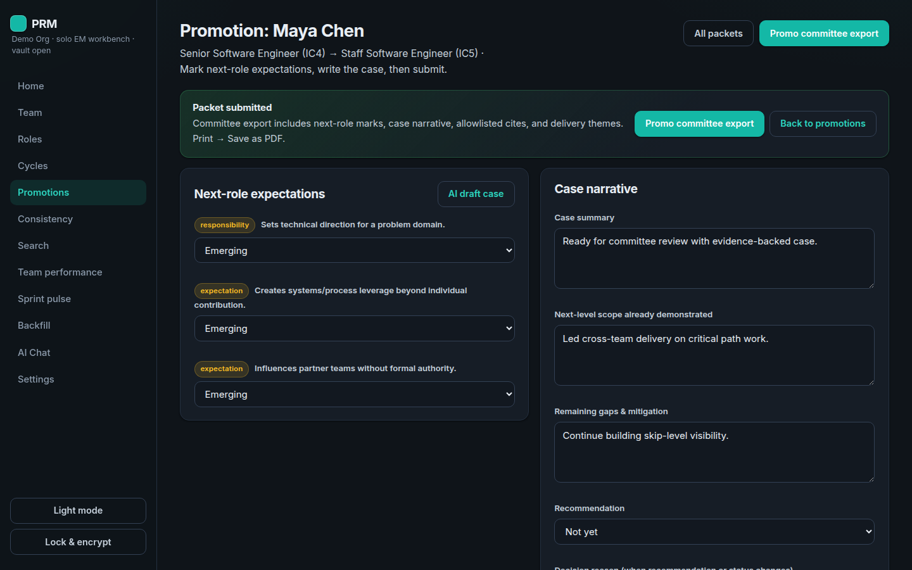

### Consistency

**Intent:** Catch unfair shape in your own drafts before anyone else sees them (everyone a 4, extreme scores with no cites, missing roles).

**How it works:** For a selected cycle, show overall rating distribution and a card per person with competencies, evidence link counts, and flags (thin evidence, extreme overall, unassigned role). Jump into each writing desk to fix gaps. This is single-EM calibration, not a multi-manager room.

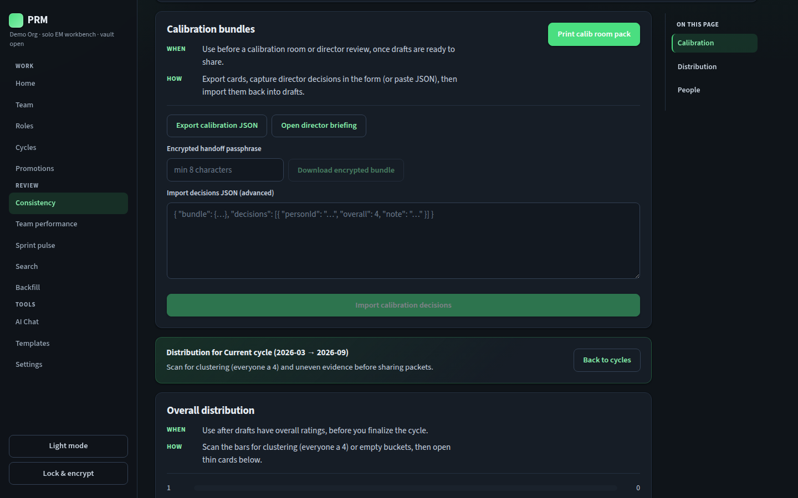

### Team performance

**Intent:** See the team's rating and coaching shape as graphs, not only as a queue of drafts.

**How it works:** Cycle-scoped charts for overall distribution, evidence vs overall, competency averages, promo readiness, writing-time buckets, level mix, and top 1:1 themes. Cross-cycle **rating trends** and **cycle compare** call out movers, repeat thin dossiers, and theme drift. The people table adds competency sparklines and prior-cycle overall deltas when history exists.

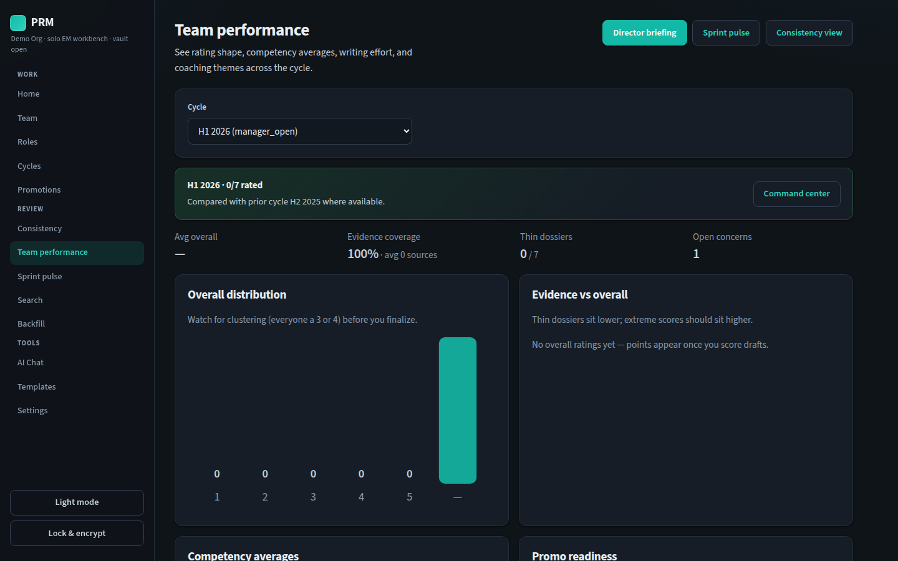

### Sprint pulse

**Intent:** Review the last sprint (or any date window) for coaching, not final ratings.

**How it works:** Pick last 7 / 14 / 30 days or a custom range. See per-person achievement volume, Jira / Bitbucket throughput, feedback themes, open concerns, and evidence freshness (in-window vs older dossier items, plus stale-only cites on manager drafts).

### Backfill

**Intent:** Unblock writing when dossiers are still empty after you first adopt the tool.

**How it works:** Lists people below the thin-dossier threshold (few achievements / feedback / docs / goals). Walk a short wizard to add starter evidence, or use MCP / integrations for bulk load. The goal is a usable citation pool, not perfect history on day one.

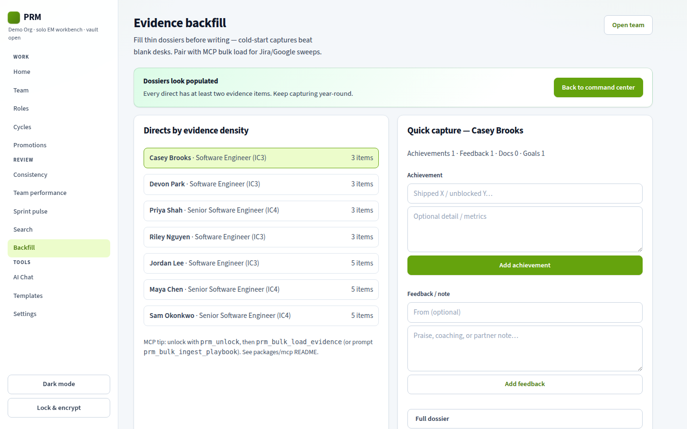

### AI Chat

**Intent:** Ask grounded questions over the workspace or a single dossier without inventing evidence.

**How it works:** Chat is scoped to workspace or person context, cites allowlisted ids from real dossier rows, and respects private-tier egress settings. It is for synthesis and retrieval, not a substitute for the writing desk finalize path.

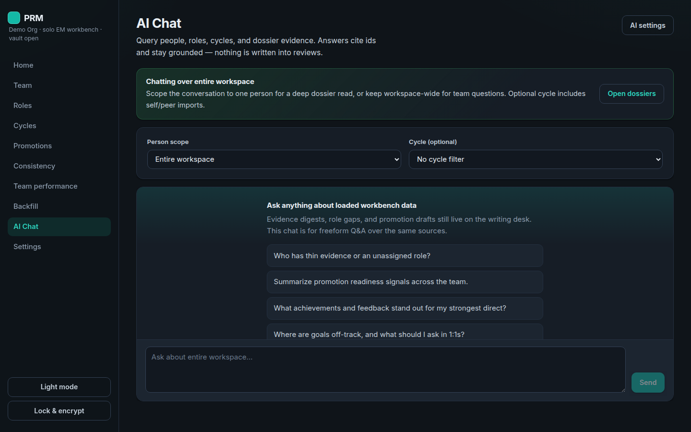

### Settings

**Intent:** Configure providers, privacy gates, appearance, and vault maintenance in one place.

**How it works:** Set AI provider and models (Anthropic, OpenAI, Cursor gateway, Ollama), toggle egress for private notes / meetings / document extracts, manage Jira and Bitbucket credentials, run encrypted backup / restore, verify the activity log, and switch dark / light theme.

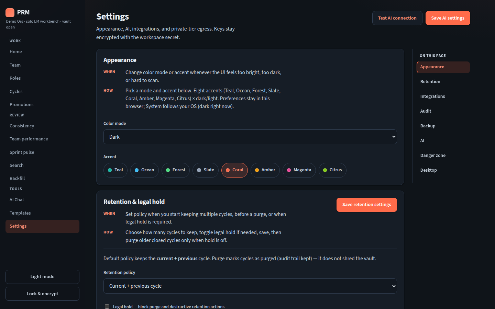

---

## What’s in this slice

- **Encrypted vault** (AES-256-GCM) for DB and dossier files on lock
- **People / roles / cycles** with self and peer JSON bundles
- **Writing desk**: competencies, evidence links, citation freeze, HTML subject packets
- **Consistency** and **team performance** views before you share (including cross-cycle trends and cycle compare)
- **Sprint pulse** for date-window coaching and evidence freshness
- **Person timeline** on each dossier
- **Bias / faithfulness lint** (advisory) on drafts
- **Promotions** against next-role expectations
- **Backfill** wizard plus MCP / Jira / Bitbucket paths for thin dossiers
- **AI**: digests, section draft, peer synthesize, chat, with citation allowlist
- **Desktop** packaging (Tauri) with CI installers on `main`
- **Dark / light** theme preference

## Docs

Product and architecture live under [`/docs`](./docs). Start with [`docs/PRODUCT_BRIEF.md`](./docs/PRODUCT_BRIEF.md). Core loop evaluation: [`docs/CORE_LOOP_EVAL.md`](./docs/CORE_LOOP_EVAL.md). Cursor cloud notes: [`AGENTS.md`](./AGENTS.md).
